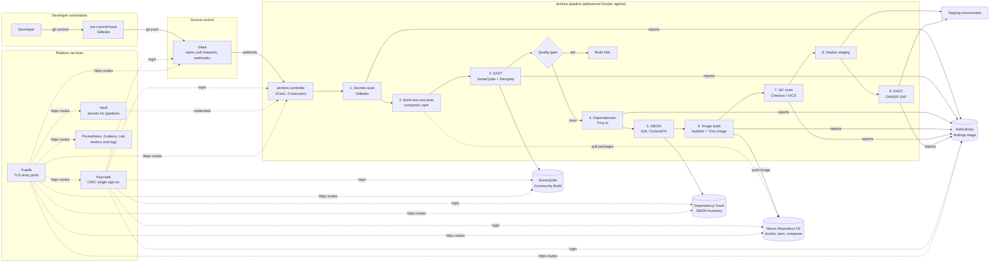

# oss-devsecops-stack

Zero-cost, self-hosted DevSecOps chain for PHP and TypeScript applications. One Docker host,
one script per component, Traefik in front of everything.

## The chain



Every arrow into DefectDojo is a report upload in the `post` block of `templates/Jenkinsfile.example`.
The quality gate is the only hard stop by default; Trivy stages also fail the build on HIGH and
CRITICAL findings, which the team can relax per project while the backlog is being cleaned.

## What each tool does

The chain has three layers: the tools developers interact with, the scanners that run inside
every build, and the platform services that hold the rest together. Each name links to its
page under `docs/`.

### Development and delivery

- [Gitea](docs/tools/gitea.md) hosts the Git repositories, pull requests and code review. It
  is where branch protection lives: a change reaches `main` only with an approved review and a
  green Jenkins status, which is what turns the scans below from advice into a gate.
- [Jenkins](docs/tools/jenkins.md) runs the pipeline. The controller only schedules; every build
  runs in a throwaway container started from an agent image that already contains the scanners.
  Its configuration is a file in this repository, not clicks in a UI.
- [SonarQube Community Build](docs/tools/sonarqube.md) measures code quality for PHP and
  TypeScript (bugs, code smells, duplication, coverage, security hotspots) and evaluates the
  quality gate that fails the build. Its free edition has no taint analysis, which is why Semgrep
  runs next to it.
- [Nexus Repository CE](docs/tools/nexus.md) caches npm, Composer and Docker Hub so builds are
  fast and reproducible even when upstream is down, and hosts the images the pipeline produces.
  Deployments pull only from here, so nothing reaches staging without having passed through a build.

### Scanners, in pipeline order

- [Gitleaks](docs/scanners/gitleaks.md) looks for passwords, keys and tokens, first in the
  developer's pre-commit hook and again on the full checkout. A leak fails the build.
- [Semgrep](docs/scanners/semgrep.md) finds code-level security bugs with rule packs for PHP and
  TypeScript, including user input flowing into a query, a shell call or an HTML output.
- [Trivy](docs/scanners/trivy.md) checks the dependency lock files and, later, the built image
  for known vulnerabilities, misconfigurations and secrets. HIGH and CRITICAL findings fail the build.
- [Syft](docs/scanners/syft.md) writes the software bill of materials, the list of every package
  in the build, so the question "are we affected by this new CVE" can be answered without rebuilding.
- [hadolint](docs/scanners/hadolint.md) lints the Dockerfile before the image is built: unpinned
  base images, root at runtime, leftover package caches.
- [Checkov](docs/scanners/checkov.md) and [KICS](docs/scanners/kics.md) scan infrastructure
  definitions (Compose files, Kubernetes manifests, Terraform) for insecure settings. One of the
  two is enough per client.
- [OWASP ZAP](docs/scanners/zap.md) attacks the application once it is deployed to staging and
  reports what an outsider sees: missing headers, injection points, weak session handling.

### Platform services

- [Traefik](docs/tools/traefik.md) is the single entry point. It terminates TLS, serves every
  tool on its own port of the host address, and discovers new services from their Docker labels.
- [Keycloak](docs/tools/keycloak.md) provides one login for every tool through OpenID Connect,
  with groups that map to roles, and can federate the client's existing directory.
- [Vault](docs/tools/vault.md) stores the secrets pipelines need (registry passwords, API tokens,
  deployment keys), hands them out for a short time with an audit trail, and is the one place to
  rotate them.
- [DefectDojo](docs/tools/defectdojo.md) receives every scanner's report, deduplicates the
  findings, assigns owners and SLAs, and gives the security lead one list instead of seven formats
  scattered across build artifacts.
- [Dependency-Track](docs/tools/dependency-track.md) keeps every build's bill of materials and
  re-checks all of them whenever a new vulnerability is published, so a library disclosed today is
  flagged in last year's release tomorrow morning.
- [Prometheus, Grafana and Loki](docs/tools/observability.md) watch the platform itself: disk,
  memory, container restarts, Jenkins queue length, and the logs of every service in one place.

Which of these a client needs on day one is a sizing and budget question: the
[minimal setup](docs/minimal-setup.md) and the [strict minimum](docs/strict-minimum.md) pages
describe the four-tool core and what each missing service costs you in practice.

## Components and run order

| Order | Component | Script | URL (`<host>` is `HOST_ADDRESS`: server name or IP) |
|---|---|---|---|
| 00 | Docker, sysctl, `.env`, network | `scripts/00-prereqs.sh` | |
| 10 | Traefik | `scripts/10-traefik.sh` | `https://<host>:443/dashboard/` |
| 20 | Keycloak | `scripts/20-keycloak.sh` | `https://<host>:8180` |
| 25 | Vault | `scripts/25-vault.sh` | `https://<host>:8200` |
| 30 | Gitea | `scripts/30-gitea.sh` | `https://<host>:3000`, SSH on 2222 |
| 40 | Jenkins + agent image + socket proxy | `scripts/40-jenkins.sh` | `https://<host>:8080` |
| 50 | SonarQube Community Build | `scripts/50-sonarqube.sh` | `https://<host>:9000` |
| 55 | Nexus Repository CE | `scripts/55-nexus.sh` | `https://<host>:8081`, registry `<host>:5000` |
| 60 | DefectDojo | `scripts/60-defectdojo.sh` | `https://<host>:8083` |
| 65 | Dependency-Track | `scripts/65-dependency-track.sh` | `https://<host>:8090`, API `https://<host>:8091` |
| 70 | Prometheus, Grafana, Loki, Promtail, exporters | `scripts/70-observability.sh` | `https://<host>:3001`, `https://<host>:9090` |
| 80 | Scanner CLI wrappers (Trivy, Gitleaks, Semgrep, Syft, hadolint, Checkov, KICS, ZAP) | `scripts/80-scanners.sh` | |

Each component is a Docker Compose project under `stacks/<name>/` with its data under
`${DATA_ROOT}/<name>/`. Image tags live in `versions.env`. Secrets live in `.env` (mode 600, git-ignored).

## Requirements

Sized for five builds running at the same time (`JENKINS_MAX_AGENTS=5`). Full detail,
per-service budgets and the two-host layout are in [docs/sizing.md](docs/sizing.md).

| Profile | vCPU | RAM | Disk |
|---|---|---|---|
| Minimum, single host | 16 | 48 GB | 500 GB SSD |
| Recommended, single host | 24 | 64 GB | 1 TB NVMe |
| Recommended, two hosts | 8 platform + 12 build | 32 GB + 32 GB | 500 GB + 300 GB |

- Debian 12/13 or Ubuntu 22.04/24.04, root access, outbound internet for image pulls and
  vulnerability feeds.
- No DNS record. Tools are reached at the host's name or IP (`HOST_ADDRESS` in `.env`), one
  port per tool as listed above; those ports and the Gitea SSH port must be free.
- A smaller host can run a subset with `--only`; the prerequisites script warns when the
  host is below the budget for the selected components and agent count. The four-tool core
  (Jenkins, Gitea, Nexus, SonarQube) with its hosts and prices is in [docs/minimal-setup.md](docs/minimal-setup.md),
  and the same four without Traefik, on host ports, in [docs/strict-minimum.md](docs/strict-minimum.md).

## Install

```bash
git clone https://github.com/MHChlagou/oss-devsecops-stack.git && cd oss-devsecops-stack
sudo HOST_ADDRESS=10.0.0.20 DATA_ROOT=/srv/devsecops ./install.sh   # everything, in order
sudo ./install.sh --list      # component names
sudo ./install.sh --only traefik,gitea,jenkins
sudo ./install.sh --skip observability
sudo ./install.sh --uninstall sonarqube   # stops the stack, keeps its data
```

The first run creates `.env` from `.env.example`, takes every setting given on the command
line (`HOST_ADDRESS`, `DATA_ROOT`, `INGRESS`, `JENKINS_MAX_AGENTS`, any key of the file) and
generates the passwords. The variables go after `sudo`, not in an `export`, because `sudo`
resets the environment. `HOST_ADDRESS` can be the server name or its IP; left out, the first
host IP is used. Later runs read `.env`, so edit that file to change a setting.

Ingress: `INGRESS=traefik` (default) puts Traefik in front of every tool, with TLS, at
`https://<host>:<port>`. `INGRESS=ports` publishes Gitea, Jenkins, SonarQube and Nexus on the
same ports with no proxy and plain HTTP, for the strict minimum profile or behind a proxy the
client already runs. Neither mode needs a DNS zone: `HOST_ADDRESS` can be an IP.

The installer keeps going when a component fails and prints the list to rerun at the end.
Rerunning a component is safe: compose only recreates what changed.

TLS: the Traefik script generates a self-signed certificate for `HOST_ADDRESS` once and
trusts it for the host's Docker daemon so image pushes to the registry work. Import
`${DATA_ROOT}/traefik/certs/server.crt` on developer machines, or drop a certificate from the
client's CA in that directory as `server.crt` and `server.key` and rerun the Traefik component
(details in [docs/tools/traefik.md](docs/tools/traefik.md)).

## Post-install checklist

1. Vault: `docker exec -it vault vault operator init`, store the unseal keys offline, unseal.
2. Nexus: read `${DATA_ROOT}/nexus/data/admin.password`, log in, create `npm-proxy`,
   `composer-proxy`, `docker-hosted` (HTTP connector on port 5000, enable Docker Bearer Token realm).
3. SonarQube: change the admin password, add the webhook `https://<host>:8080/sonarqube-webhook/`,
   create a global analysis token, add it to Jenkins as `sonarqube-token`, and configure the
   server under Manage Jenkins, System, SonarQube servers with name `sonarqube`.
4. Dependency-Track: change admin password, create an automation team and API key, Jenkins credential `dtrack-api-key`.
5. DefectDojo: create an API key for a service user, Jenkins credential `defectdojo-api-key`.
6. Keycloak: create realm `devsecops`, one OIDC client per tool, then switch each tool to OIDC
   (Gitea authentication source of type OpenID Connect, Jenkins oic-auth plugin, SonarQube OIDC plugin, Grafana generic OAuth).
7. Gitea: log in as `gitea_admin`, change the password, create an organisation and a repository.
   In Jenkins add the Gitea server under Manage Jenkins, System, Gitea Servers, then create a
   Gitea Organization folder job. Webhooks go to `https://<host>:8080/gitea-webhook/post`.
   Copy `templates/Jenkinsfile.example` into the repository.
8. Developers: `cp templates/pre-commit .git/hooks/pre-commit` in every clone.
9. Backups: snapshot `${DATA_ROOT}` nightly. Gitea also offers `gitea dump` for a consistent archive.

## Documentation

One page per tool under [docs/](docs/README.md): role in the chain, deployment facts,
first-run steps, integrations, operations and free edition limits. Hardware sizing for
five parallel builds is in [docs/sizing.md](docs/sizing.md).

## Security notes

- Jenkins runs with zero executors; every build runs in a throwaway `devsecops/jenkins-agent:local` container.
- The Docker socket is never mounted into Jenkins. A socket proxy exposes only the endpoints the
  Docker plugin needs. This is still host-root-equivalent for anyone who can define a pipeline, so
  restrict job creation to trusted users or move agents to Kubernetes when the client has a cluster.
- Gitea registration is disabled and anonymous browsing is off. Accounts come from Keycloak once
  the OIDC source is configured.
- No installer step prints a secret. Generated passwords are only in `.env`; Vault unseal keys are
  shown once by Vault itself and never stored by these scripts.
- Scanner versions are pinned in `versions.env`; the host wrappers and the Jenkins agent use the same images.

## Cost

Every component is free for private self-hosted use. Watch the Nexus Community Edition cap
(100,000 components, 200,000 requests per day) and SonarQube Community's lack of branch
analysis, which is why Semgrep runs alongside it.
