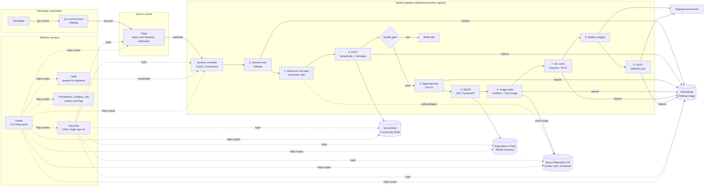

# oss-devsecops-stack

Zero-cost, self-hosted DevSecOps chain for PHP and TypeScript applications. One Docker host,
one script per component, Traefik in front of everything.

## The chain



Every arrow into DefectDojo is a report upload in the `post` block of `templates/Jenkinsfile.example`.
The quality gate is the only hard stop by default; Trivy stages also fail the build on HIGH and
CRITICAL findings, which the team can relax per project while the backlog is being cleaned.

## Components and run order

| Order | Component | Script | URL |
|---|---|---|---|
| 00 | Docker, sysctl, `.env`, network | `scripts/00-prereqs.sh` | |
| 10 | Traefik | `scripts/10-traefik.sh` | `traefik.<domain>` |
| 20 | Keycloak | `scripts/20-keycloak.sh` | `keycloak.<domain>` |
| 25 | Vault | `scripts/25-vault.sh` | `vault.<domain>` |
| 30 | Gitea | `scripts/30-gitea.sh` | `gitea.<domain>`, SSH on 2222 |
| 40 | Jenkins + agent image + socket proxy | `scripts/40-jenkins.sh` | `jenkins.<domain>` |
| 50 | SonarQube Community Build | `scripts/50-sonarqube.sh` | `sonarqube.<domain>` |
| 55 | Nexus Repository CE | `scripts/55-nexus.sh` | `nexus.<domain>`, `registry.<domain>` |
| 60 | DefectDojo | `scripts/60-defectdojo.sh` | `defectdojo.<domain>` |
| 65 | Dependency-Track | `scripts/65-dependency-track.sh` | `dtrack.<domain>`, `dtrack-api.<domain>` |
| 70 | Prometheus, Grafana, Loki, Promtail, exporters | `scripts/70-observability.sh` | `grafana.<domain>`, `prometheus.<domain>` |
| 80 | Scanner CLI wrappers (Trivy, Gitleaks, Semgrep, Syft, hadolint, Checkov, KICS, ZAP) | `scripts/80-scanners.sh` | |

Each component is a Docker Compose project under `stacks/<name>/` with its data under
`${DATA_ROOT}/<name>/`. Image tags live in `versions.env`. Secrets live in `.env` (mode 600, git-ignored).

## Requirements

- Debian 12/13 or Ubuntu 22.04/24.04 host, root access, outbound internet for image pulls.
- Full stack: 8 CPUs, 16 GB RAM, 150 GB disk. SonarQube wants 2 GB, Nexus 2 GB,
  Dependency-Track 4 GB, Gitea under 1 GB. A smaller host can install a subset with `--only`.
- A wildcard DNS record `*.<domain>` pointing at the host (internal DNS is fine).
- Ports 80, 443 and the Gitea SSH port free.

## Install

```bash
git clone https://github.com/MHChlagou/oss-devsecops-stack.git && cd oss-devsecops-stack
cp .env.example .env          # optional: prereqs does it if missing
vi .env                       # set DOMAIN, DATA_ROOT; leave passwords empty to auto-generate
sudo ./install.sh             # everything, in order
sudo ./install.sh --list      # component names
sudo ./install.sh --only traefik,gitea,jenkins
sudo ./install.sh --skip observability
sudo ./install.sh --uninstall sonarqube   # stops the stack, keeps its data
```

The installer keeps going when a component fails and prints the list to rerun at the end.
Rerunning a component is safe: compose only recreates what changed.

TLS: on a private network leave `CERT_RESOLVER` empty and Traefik serves a self-signed
certificate. Replace it with the client's internal CA certificate later by adding a
file provider to `${DATA_ROOT}/traefik/traefik.yml`. With public DNS, set `CERT_RESOLVER=le`
and `ACME_EMAIL` for Let's Encrypt.

## Post-install checklist

1. Vault: `docker exec -it vault vault operator init`, store the unseal keys offline, unseal.
2. Nexus: read `${DATA_ROOT}/nexus/data/admin.password`, log in, create `npm-proxy`,
   `composer-proxy`, `docker-hosted` (HTTP connector on port 5000, enable Docker Bearer Token realm).
3. SonarQube: change the admin password, create a token, add it to Jenkins as `sonarqube-token`,
   and configure the server under Manage Jenkins, System, SonarQube servers with name `sonarqube`.
4. Dependency-Track: change admin password, create an automation team and API key, Jenkins credential `dtrack-api-key`.
5. DefectDojo: create an API key for a service user, Jenkins credential `defectdojo-api-key`.
6. Keycloak: create realm `devsecops`, one OIDC client per tool, then switch each tool to OIDC
   (Gitea authentication source of type OpenID Connect, Jenkins oic-auth plugin, SonarQube OIDC plugin, Grafana generic OAuth).
7. Gitea: log in as `gitea_admin`, change the password, create an organisation and a repository.
   In Jenkins add the Gitea server under Manage Jenkins, System, Gitea Servers, then create a
   Gitea Organization folder job. Webhooks go to `https://jenkins.<domain>/gitea-webhook/post`.
   Copy `templates/Jenkinsfile.example` into the repository.
8. Developers: `cp templates/pre-commit .git/hooks/pre-commit` in every clone.
9. Backups: snapshot `${DATA_ROOT}` nightly. Gitea also offers `gitea dump` for a consistent archive.

## Security notes

- Jenkins runs with zero executors; every build runs in a throwaway `devsecops/jenkins-agent:local` container.
- The Docker socket is never mounted into Jenkins. A socket proxy exposes only the endpoints the
  Docker plugin needs. This is still host-root-equivalent for anyone who can define a pipeline, so
  restrict job creation to trusted users or move agents to Kubernetes when the client has a cluster.
- Gitea registration is disabled and anonymous browsing is off. Accounts come from Keycloak once
  the OIDC source is configured.
- No installer step prints a secret. Generated passwords are only in `.env`; Vault unseal keys are
  shown once by Vault itself and never stored by these scripts.
- Scanner versions are pinned in `versions.env`; the host wrappers and the Jenkins agent use the same images.

## Cost

Every component is free for private self-hosted use. Watch the Nexus Community Edition cap
(100,000 components, 200,000 requests per day) and SonarQube Community's lack of branch
analysis, which is why Semgrep runs alongside it.
