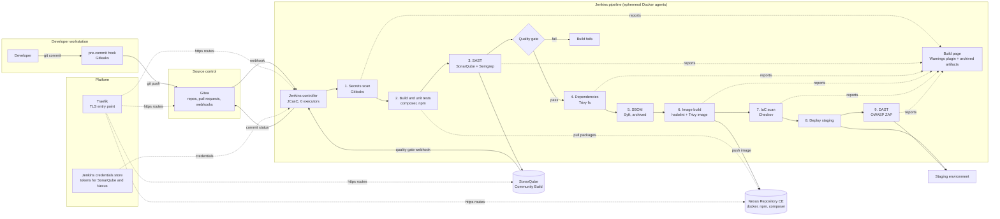

# Minimal setup: Jenkins, Gitea, Nexus, SonarQube

The strict minimum that still deserves the name DevSecOps: source control, a pipeline, a
quality gate, an artifact store, and the scanners baked into the Jenkins agent image.
Traefik stays because something has to terminate TLS. Everything else
in the full stack can be added later with `--only`, one component at a time. The same four
tools without Traefik, on host ports, are the [strict minimum](strict-minimum.md).

## The chain



Compared with the full chain, the report arrows end on the Jenkins build page instead of
DefectDojo, the SBOM is archived instead of uploaded to Dependency-Track, credentials come
from the Jenkins store instead of Vault, each tool keeps its own login instead of Keycloak,
and nothing watches the platform itself.

## Install

```bash
sudo ./install.sh --only traefik,gitea,jenkins,sonarqube,nexus,scanners
```

Set `JENKINS_MAX_AGENTS` in `.env` to the number of parallel builds the host is sized for
(see below) before running. The prerequisites script computes its RAM and CPU warning from
the components actually selected, so it will not complain about memory reserved for tools you
did not install.

## What is in, what is out

| Need | Minimal setup | What the full stack adds |
|---|---|---|
| Source control, reviews, webhooks | Gitea | same |
| Pipeline, gates, ephemeral build agents | Jenkins | same |
| Code quality gate | SonarQube Community Build | same |
| Packages and images | Nexus Repository CE | same |
| Secrets, dependency, image, IaC and dynamic scans | Gitleaks, Semgrep, Trivy, Syft, hadolint, Checkov, ZAP in the agent image; results shown on the Jenkins build page by the Warnings plugin and archived as artifacts | DefectDojo as one triage inbox with deduplication and SLAs |
| Pipeline credentials | Jenkins credentials store | Vault with AppRole, audit log and rotation |
| Login | one local user list per tool (four of them) | Keycloak single sign-on |
| SBOM | generated by Syft, archived per build | Dependency-Track re-checks every past release against new CVEs |
| Platform monitoring | the client's existing monitoring, or nothing | Prometheus, Grafana, Loki with alert rules |

The security scans are the same in both setups. What the minimal setup lacks is memory:
findings are only attached to builds, credentials are only as safe as the Jenkins controller,
and nobody is told when an old release becomes vulnerable. For one team and a handful of
applications that is a reasonable starting point; for several teams or an audit requirement,
add DefectDojo first, then Vault.

## Resource budget

Per-service budgets are the ones from [sizing.md](sizing.md); only the selection changes.

| Component | vCPU idle | vCPU under load | RAM |
|---|---|---|---|
| Traefik | 0.1 | 0.5 | 128 MB |
| Gitea + PostgreSQL | 0.2 | 1 | 1.5 GB |
| Jenkins controller | 0.3 | 1.5 | 2.5 GB |
| SonarQube + PostgreSQL | 0.5 | 2.5 | 5 GB |
| Nexus Repository CE | 0.3 | 2 | 4.5 GB |
| Docker engine, OS, page cache | 0.5 | 1 | 3 GB |
| Platform total | 2 | 8.5 | 17 GB |
| Each parallel build | 2 | 3 | 4 GB |

Disk: 300 GB after a year with the same retention assumptions as the full stack (Nexus
proxied packages and images are the bulk), on SSD.

## Minimum hosts

| Parallel builds | vCPU | RAM | Disk | Standard cloud shape |
|---|---|---|---|---|
| 3 | 8 | 32 GB | 300 GB SSD | 8 vCPU, 32 GB general purpose |
| 5, single host | 8 | 64 GB | 300 GB SSD | 8 vCPU, 64 GB memory optimised (platform plus five agents is 37 GB, which no 32 GB shape holds) |
| 5, two hosts | 4 + 8 | 16 GB + 32 GB | 200 GB + 150 GB | platform on a small on-demand VM, agents on a spot or preemptible VM |

CPU can be oversubscribed: eight vCPU for five concurrent builds means slower builds, not
failures. RAM cannot: the JVMs of Jenkins, SonarQube and Nexus reserve their heaps at start,
and a build agent that gets killed by the out-of-memory handler fails the pipeline.

## Monthly cost

Approximate on-demand list prices in a European region in 2026, before taxes. A one-year
commitment on the platform host saves another 30 to 40 percent on the three hyperscalers.
Software costs nothing in any column.

| Layout | AWS | Azure | Google Cloud | Hetzner (dedicated or cloud), for comparison |
|---|---|---|---|---|
| Single host, 3 builds: 8 vCPU, 32 GB | m6i.2xlarge, about 280 USD | D8s v5, about 280 USD | n2-standard-8, about 280 USD, about 230 after the automatic sustained use discount | CCX33, about 60 EUR |
| Single host, 5 builds: 8 vCPU, 64 GB | r6i.2xlarge, about 370 USD | E8s v5, about 370 USD | n2-highmem-8, about 350 USD, under 300 after discount | CCX43 (16 vCPU, 64 GB), about 120 EUR; dedicated AX42 (64 GB), about 60 EUR |
| Two hosts, 5 builds: platform 4 vCPU 16 GB on demand plus build host 8 vCPU 32 GB on spot | m6i.xlarge plus spot m6i.2xlarge, about 140 + 85 = 225 USD | D4s v5 plus spot D8s v5, about 140 + 90 = 230 USD | n2-standard-4 plus spot n2-standard-8, about 130 + 75 = 205 USD | one dedicated box already covers it |
| Storage, 300 GB SSD, per host set | about 25 USD | about 45 USD | about 30 USD | included |
| Backups, 500 GB object storage | about 12 USD | about 10 USD | about 10 USD | Storage Box, about 4 EUR |

Expect 250 to 420 USD per month on a hyperscaler depending on layout, against 600 to 800 for
the full stack, and 60 to 130 EUR on a dedicated server provider. The spot build host is the
cheapest option and also the safest, because a runaway build cannot starve Gitea or SonarQube.

None of the three hyperscalers has a region in Tunisia; the nearest are Paris and Milan. If
the client requires code and credentials to stay in the country, this page applies to their
own hardware, and the host sizes above are what to ask the hardware team for.

## Growing from here

Each addition is one command and costs the RAM listed in [sizing.md](sizing.md):

```bash
sudo ./install.sh --only defectdojo          # +3 GB, findings triage
sudo ./install.sh --only vault               # +256 MB, secrets out of Jenkins
sudo ./install.sh --only keycloak            # +1.5 GB, single sign-on
sudo ./install.sh --only dependency-track    # +5.5 GB, SBOM re-analysis
sudo ./install.sh --only observability       # +2.5 GB, dashboards and alerts
```

The pipeline template already uploads to DefectDojo and Dependency-Track; on the minimal
setup those steps are skipped by removing the credentials and the two upload blocks from
the Jenkinsfile, and restored when the tools arrive.
