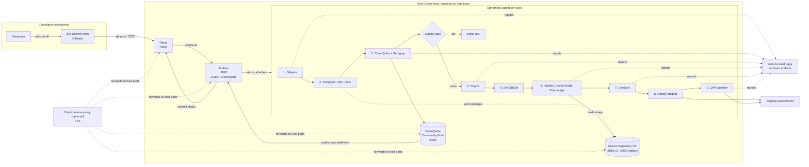

# Strict minimum: Gitea, Jenkins, SonarQube, Nexus

Four containers' worth of platform and nothing else. No reverse proxy, no single sign-on,
no secrets store, no findings inbox, no monitoring. Each tool is published on a host port
over plain HTTP, and TLS is either absent (a pilot inside a private network) or provided by a
reverse proxy the client already runs. The security scanners still run on every build, because
they live in the Jenkins agent image that `scripts/40-jenkins.sh` builds.

This is the smallest configuration the installer supports. The [minimal setup](minimal-setup.md)
is the same four tools plus Traefik for hostnames and TLS, and is the better choice whenever
the client does not already have a proxy.

## The chain



## Install

In `.env`, before the first run:

```ini
INGRESS=ports
HOST_ADDRESS=10.0.0.20        # server name or IP developers use to reach the host; defaults to the first host IP
JENKINS_MAX_AGENTS=3          # or 5 with 64 GB, see below
```

Then:

```bash
sudo ./install.sh --only gitea,jenkins,sonarqube,nexus
```

Or, without touching `.env`, give the settings on the first run; they are written into the
file it creates:

```bash
sudo INGRESS=ports HOST_ADDRESS=10.0.0.20 JENKINS_MAX_AGENTS=3 ./install.sh --only gitea,jenkins,sonarqube,nexus
```

With `INGRESS=ports` the installer publishes Gitea on 3000, Jenkins on 8080, SonarQube on
9000, Nexus on 8081 and its Docker registry on 5000 (all adjustable in `.env`), derives each
tool's public URL from `HOST_ADDRESS`, and refuses to install the Traefik-only components.
If the client's proxy fronts the tools, set `GITEA_URL`, `JENKINS_URL`, `SONARQUBE_URL`,
`NEXUS_URL` and `REGISTRY_HOST` in `.env` to the proxy's hostnames so that redirects,
webhooks and clone URLs are right, and let the proxy forward to the ports above.

## Consequences of no proxy

- Plain HTTP between developers and the tools unless the client's proxy adds TLS. Passwords
  and tokens cross the network in clear text on a pilot network; do not run this exposed to
  the internet.
- The Nexus Docker registry is insecure for the Docker client. Every machine that pushes or
  pulls, including the build host, needs `"insecure-registries": ["HOST:5000"]` in
  `/etc/docker/daemon.json`, and the `IMAGE` variable in the Jenkinsfile becomes
  `HOST:5000/<app>:<tag>`.
- Gitea's webhook allow-list is reduced to `HOST_ADDRESS`. Gitea matches hosts, not ports, so a
  repository admin can aim a webhook at any port of the platform host, all of which developers
  reach anyway in this profile, and at nothing else on the network. If even that is too wide,
  set `GITEA_WEBHOOK_ALLOWED_HOSTS=jenkins` in `.env` and create webhooks by hand with the
  internal URL `http://jenkins:8080/gitea-webhook/post`; Jenkins-managed hooks then stop working
  because the plugin registers the public URL.
- Firewall: open 2222, 3000, 8080, 8081, 9000 and 5000 to developers, nothing to the internet.
- Scanner wrappers on the host (`scripts/80-scanners.sh`) are not installed by the command
  above; add `scanners` to `--only` if operators want to run the tools by hand.

Everything else from the [minimal setup](minimal-setup.md) applies: findings stay on the
Jenkins build page, credentials in the Jenkins store, one user list per tool, no CVE re-check
of old releases, and the client monitors the host with their own tooling.

## Resource budget

Dropping Traefik saves 128 MB; the budget is otherwise the minimal setup's.

| Component | vCPU idle | vCPU under load | RAM |
|---|---|---|---|
| Gitea + PostgreSQL | 0.2 | 1 | 1.5 GB |
| Jenkins controller | 0.3 | 1.5 | 2.5 GB |
| SonarQube + PostgreSQL | 0.5 | 2.5 | 5 GB |
| Nexus Repository CE | 0.3 | 2 | 4.5 GB |
| Docker engine, OS, page cache | 0.5 | 1 | 3 GB |
| Platform total | 2 | 8 | 17 GB |
| Each parallel build | 2 | 3 | 4 GB |

## Minimum hosts

| Parallel builds | vCPU | RAM | Disk |
|---|---|---|---|
| 1 or 2 (pilot) | 4 | 24 GB | 200 GB SSD |
| 3 | 8 | 32 GB | 300 GB SSD |
| 5 | 8 | 64 GB, or two hosts of 16 GB + 32 GB | 300 GB SSD |

The prerequisites script checks the host against the selected components, so on this profile
a 32 GB host with `JENKINS_MAX_AGENTS=3` passes without warnings.

## Monthly cost

Identical to the minimal setup, since Traefik's 128 MB does not change the instance shape.
Approximate on-demand list prices, European region, software at zero in every column.

| Layout | AWS | Azure | Google Cloud | Hetzner, for comparison |
|---|---|---|---|---|
| Pilot, 2 builds: 4 vCPU, 32 GB (smallest shape with enough RAM) | r6i.xlarge, about 185 USD | E4s v5, about 185 USD | n2-highmem-4, about 175 USD, under 150 after discount | CCX23 (4 vCPU, 16 GB) is too small; CCX33, about 60 EUR |
| 3 builds: 8 vCPU, 32 GB | m6i.2xlarge, about 280 USD | D8s v5, about 280 USD | n2-standard-8, about 280 USD, about 230 after discount | CCX33, about 60 EUR |
| 5 builds: 8 vCPU, 64 GB | r6i.2xlarge, about 370 USD | E8s v5, about 370 USD | n2-highmem-8, about 350 USD, under 300 after discount | CCX43 or dedicated AX42, 60 to 120 EUR |
| 5 builds, two hosts: 4 vCPU 16 GB on demand plus 8 vCPU 32 GB spot | about 225 USD | about 230 USD | about 205 USD | one dedicated box |
| Storage, 300 GB SSD | about 25 USD | about 45 USD | about 30 USD | included |

Full tables, backups and the regional note are in [minimal-setup.md](minimal-setup.md).

## Growing from here

Add Traefik first. The four containers hold the host ports that Traefik needs, so stop them
before switching the mode; the data is kept:

```bash
sudo ./install.sh --uninstall all
sed -i 's/^INGRESS=.*/INGRESS=traefik/' .env
sudo ./install.sh --only traefik,gitea,jenkins,sonarqube,nexus
```

Traefik then serves every tool under its own path on one HTTPS port, `https://<host>/gitea`
and so on, with a certificate generated for `HOST_ADDRESS` (see [traefik.md](tools/traefik.md)),
and the rerun tells each tool its new URL. After that, add the other components one at a time
as described in the minimal setup page. Every URL changes: webhooks and developer remotes
created before the switch need updating, so decide the ingress mode before the first
repository is created.
